# Arquitectura del Sistema

**Proyecto:** Buscador y Visor de Documentos Técnicos

**Alcance:** este documento describe el UI web y el backend tal como están implementados en el repositorio (React/Vite, módulos NestJS, esquema Prisma/PostgreSQL, migraciones SQL y `docker-compose.yml`). Cada afirmación se puede verificar en los archivos citados.

---

## 1. Diagramas de arquitectura y flujo

### 1.1 Vista general del sistema

Vista de alto nivel del UI web y los servicios que lo respaldan. Los flujos detallados de cada endpoint están separados en las secciones siguientes.

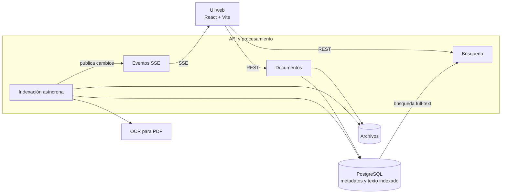

### 1.2 Documents

Cada endpoint de `Documents` tiene su propio diagrama para mostrar con claridad su flujo.

#### `GET /api/v1/documents`

Lista metadatos con filtros y paginación; la respuesta no incluye `content` ni `storageName`.

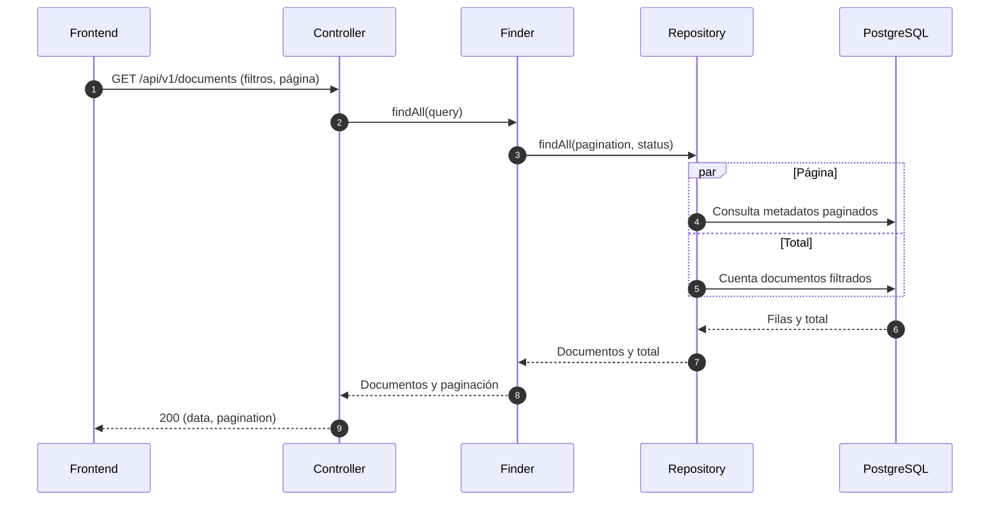

#### `GET /api/v1/documents/count`

Devuelve los conteos de documentos por estado, opcionalmente filtrados por búsqueda.

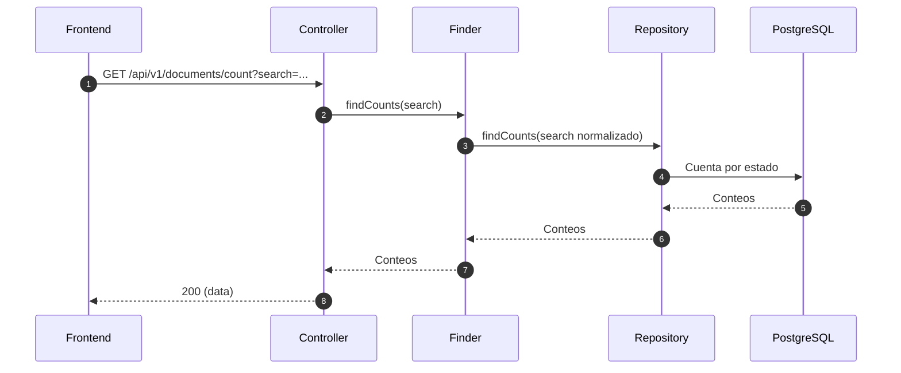

#### `GET /api/v1/documents/:id`

Busca un documento por UUID y excluye el contenido y el nombre interno del archivo de la respuesta.

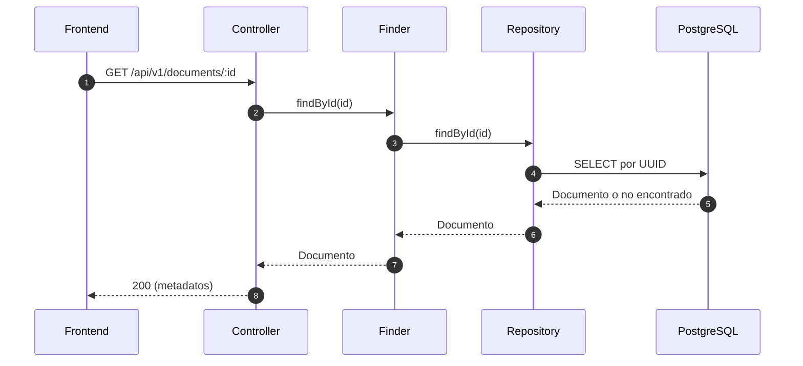

#### `GET /api/v1/documents/:id/file`

Transmite siempre el archivo original. El UI lo usa para el botón **Descargar original** y para leer TXT/Markdown; en PDF también solicita `/preview` para mostrar el derivado OCR cuando está disponible. Aunque `/preview` sirve el original como alternativa, no reemplaza esta ruta cuando se requiere descargar el original después de completar OCR.

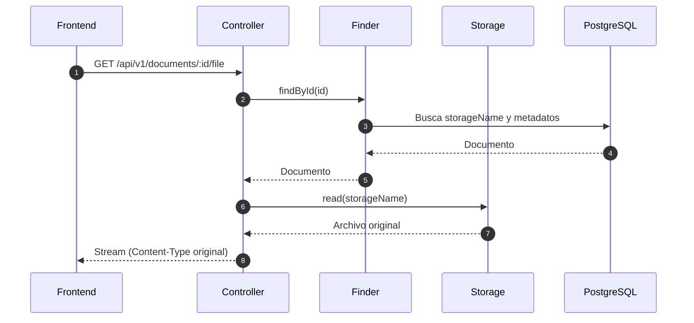

#### `GET /api/v1/documents/:id/preview`

Transmite el PDF con capa OCR si está disponible; si aún no existe o el documento no es PDF, transmite el original. Esta ruta es para la vista previa, no para descargar el archivo fuente.

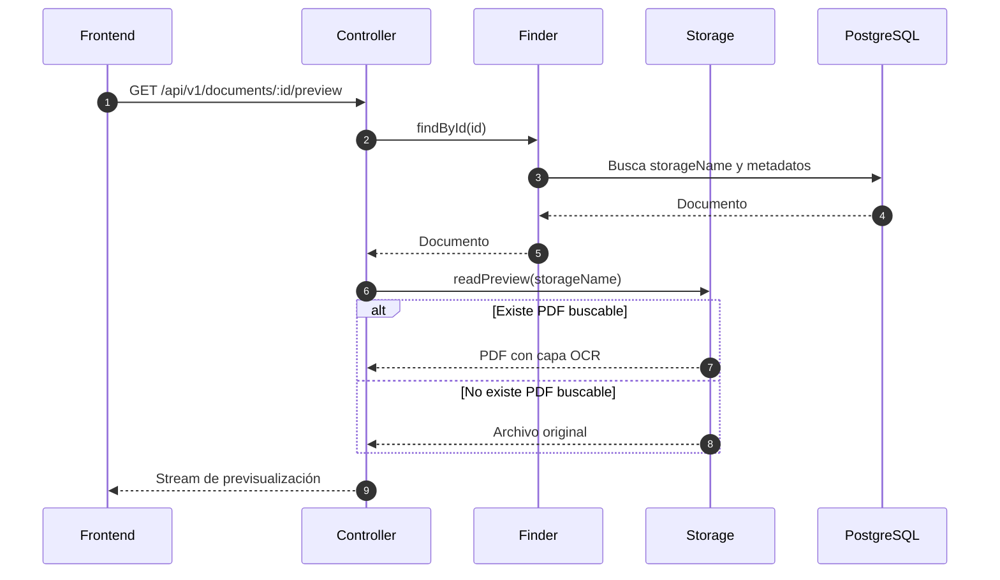

#### `POST /api/v1/documents`

Guarda el original y responde `201` en estado `PROCESSING`. Después, el worker aplica OCR a los PDF que lo requieren, extrae el texto y lo indexa; el UI recibe el cambio por la conexión SSE compartida (§1.5).

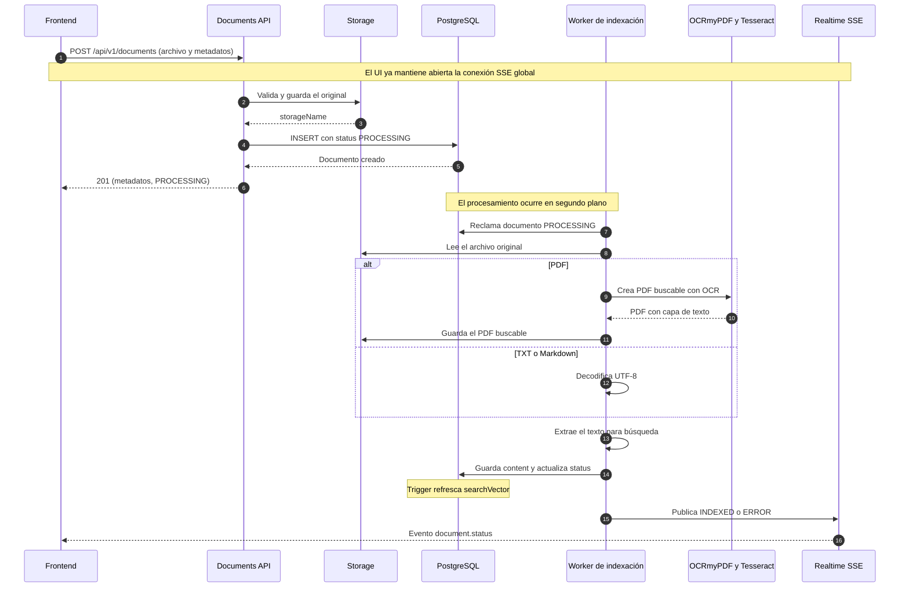

#### `PATCH /api/v1/documents/:id`

Verifica que el documento exista y que haya al menos un campo para actualizar; PostgreSQL refresca `searchVector` mediante el trigger.

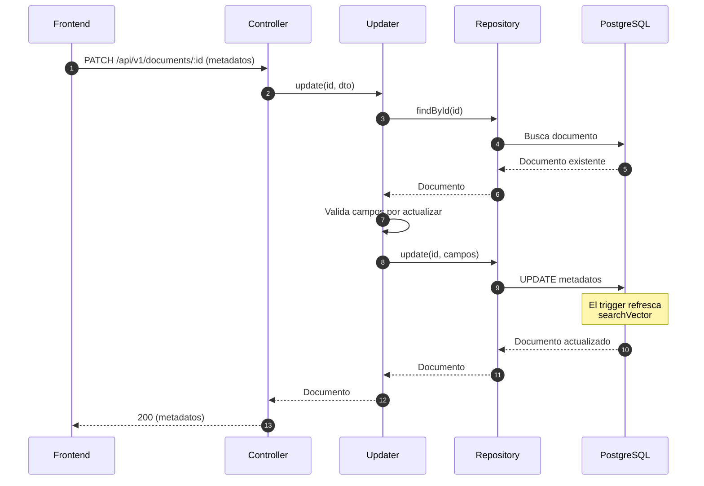

#### `DELETE /api/v1/documents/:id`

Elimina primero el registro y luego el archivo original y su derivado de búsqueda.

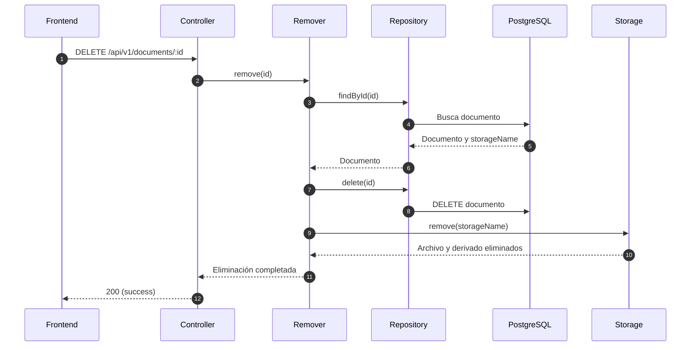

### 1.3 Search

#### `GET /api/v1/search`

La página de resultados y el total se calculan en paralelo contra el mismo índice GIN.

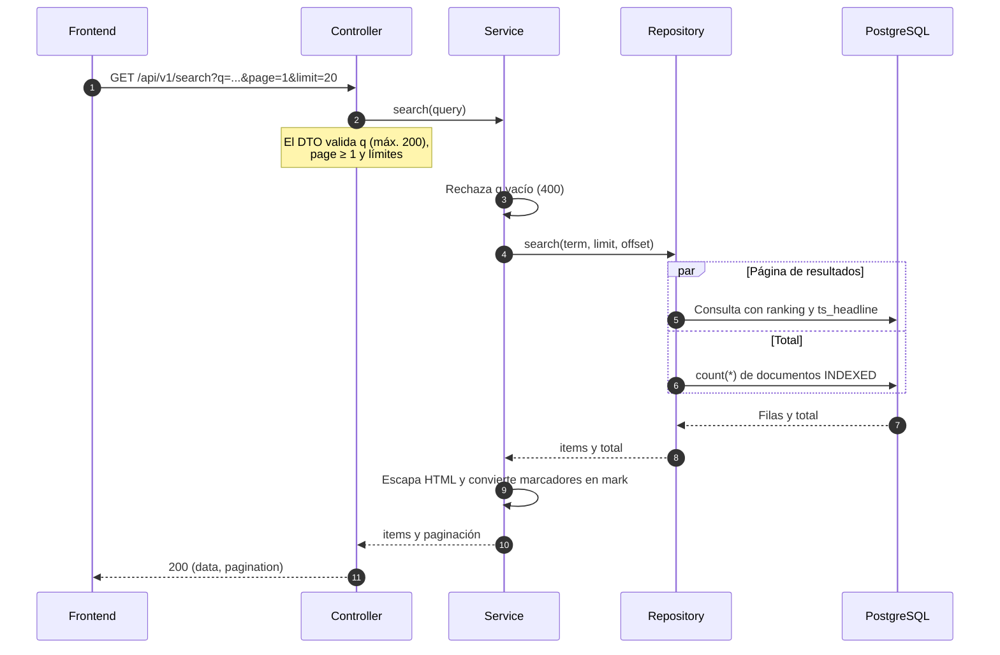

Detalle de la consulta de la página: los términos normales se convierten en lexemas prefijo con `to_tsquery('simple', ...)` (por ejemplo, `prue:*` encuentra `prueba`); varios términos se combinan con AND. Las consultas entre comillas y operadores mantienen `websearch_to_tsquery('simple', q)`. Ambas consultan `searchVector` y ordenan por `ts_rank_cd DESC` y luego `createdAt DESC`. Para no ejecutar `ts_headline` sobre contenidos OCR de varios millones de caracteres, el fragmento se limita a 3.000 caracteres alrededor de la primera aparición del término de búsqueda; los metadatos completos también se incluyen.

> Solo se devuelven documentos con `status = 'INDEXED'`. Uno en `PROCESSING` o `ERROR` nunca aparece en los resultados aunque su fila exista (`prisma-search.repository.ts`).

### 1.4 Realtime

#### `GET /api/v1/realtime/documents`

Abre un stream SSE global con cambios de estado de todos los documentos y un heartbeat cada 15 segundos.

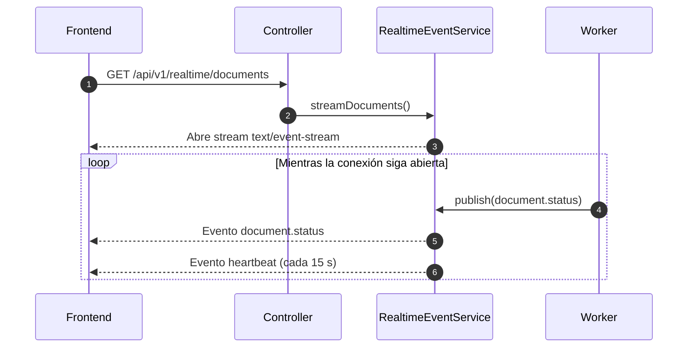

### 1.5 Indexación asíncrona

El worker se activa al iniciar el módulo y procesa los documentos pendientes hasta vaciar la cola; luego vuelve a comprobarla un segundo después. El UI mantiene abierto el `EventSource` compartido y actualiza los documentos cuando recibe su estado terminal.

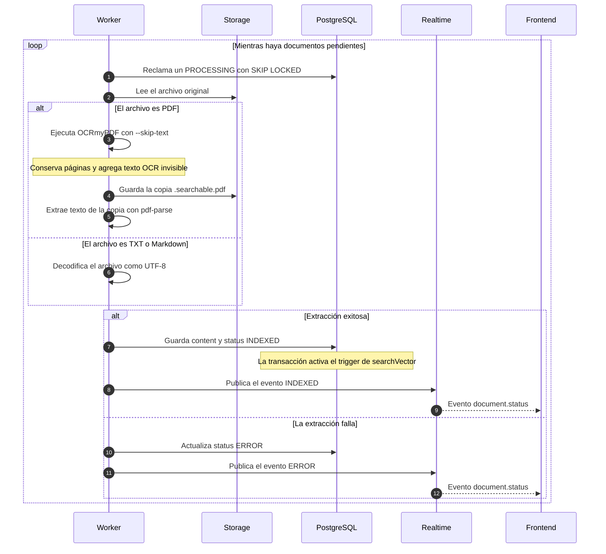

### 1.6 Vista y resaltado de PDFs

Para PDF, el UI pide `GET /api/v1/documents/:id/preview` para mostrar la copia `.searchable.pdf` si ya existe; mientras se procesa sirve el original. PDF.js renderiza la capa OCR invisible sobre las imágenes originales y coloca resaltados en las coordenadas del texto reconocido. `GET /api/v1/documents/:id/file` se mantiene separado para entregar el original al botón de descarga y para leer TXT/Markdown. El PDF derivado se guarda junto al original y se elimina al borrar el documento.

---

## 2. Justificación de las decisiones

### 2.1 Rendimiento (400 ms a 1 s)

Toda búsqueda debe responder entre 400 ms y 1 s, prohíbe `LIKE` y equivalentes sin índice. Cada decisión ataca una causa concreta de latencia, eligiendo siempre la opción más simple que cumple el rango sin añadir infraestructura.

- **Índice invertido.** Se eligio PostgreSQL FTS con `tsvector` + GIN porque la consulta se resuelve en el mismo motor que guarda los datos, sin salto de red ni serialización adicional. Además, el ranking (`ts_rank_cd`) y el resaltado (`ts_headline`) salen en la misma sentencia.
- **Trabajo pesado fuera de la petición.** Un `POST` síncrono que extrajera y tokenizara el texto heredaría el peor caso de un PDF grande. Por eso se responde `201` con `PROCESSING` y el worker hace la extracción (§1.5). La escritura se reduce a validar el archivo y hacer un `INSERT`, y el aviso de término llega por SSE. Se descartó el polling porque multiplica las peticiones sin ser más inmediato.
- **Límites duros en el DTO.** Sin tope, un `limit` arbitrario obligaría a ordenar y materializar miles de filas con su snippet. Se fija `limit` en [1, 100], `q` en 200 caracteres como máximo y fragmentos acotados (`MaxFragments=2`, `MinWords=8`, `MaxWords=24`). Así el coste de cada consulta tiene techo, sin importar lo que pida el cliente.
- **Página y total en paralelo.** Calcular `count(*)` después de la página aumenta la latencia percibida aproximadamente al doble. Con `Promise.all` el tiempo total es el de la consulta más lenta. Se prefirió el conteo exacto a las estimaciones de catálogo porque el conjunto filtrado ya usa el mismo índice GIN.
- **Optimización medida del resaltado.** Se analizó la consulta con `EXPLAIN (ANALYZE, BUFFERS)` y mediciones directas de la API. Se encontró que `ts_headline` procesaba documentos OCR de alrededor de cuatro millones de caracteres. Limitar su entrada a una ventana contextual de 3.000 caracteres alrededor de la coincidencia mantuvo el ranking, el conteo y el resaltado, y redujo la latencia observada para la consulta de ejemplo de aproximadamente 3,2 s a 0,42–0,46 s.
- **Pool de conexiones reutilizado.** Abrir una conexión por petición sumaría decenas o cientos de milisegundos de handshake a cada búsqueda. `@prisma/adapter-pg` mantiene un pool (`DATABASE_MAX_POOL_SIZE=10`) con timeouts de conexión e inactividad, de modo que el coste de conectar se amortiza y el agotamiento se detecta rápido en lugar de dejar la petición colgada.
- **Fragmento de búsqueda acotado.** `ts_headline` opera sobre los metadatos y una ventana de 3.000 caracteres alrededor del primer término encontrado en el contenido, no sobre el documento OCR completo. Esto mantiene contexto relevante y evita que documentos largos dominen la latencia.
- **No transferir contenido innecesario.** Incluir `content` completo en `/documents` dominaría el tamaño de la respuesta y el tiempo de serialización. Los listados y detalles excluyen `content` y `storageName`, y el buscador devuelve solo el snippet de `ts_headline`.

### 2.2 Stack

| Elección | Por qué |
| --- | --- |
| **NestJS 12 + TypeScript (ESM)** | Módulos con inyección de dependencias, que permiten separar dominio e infraestructura (§2.5). `@Sse()` nativo sobre RxJS, `ValidationPipe` global con `whitelist`, prefijo `api` con versionado URI `v1` y Swagger generado desde decoradores (`config/swagger.config.ts`) |
| **PostgreSQL 16** | Una sola base cubre metadatos, contenido, estados y búsqueda: `tsvector`/`tsquery`, GIN, arrays (`tags TEXT[]`), `ENUM` y `FOR UPDATE SKIP LOCKED`. Evita sincronizar un buscador externo |
| **Prisma 6 + `@prisma/adapter-pg`** | Modelo declarativo y migraciones SQL versionadas. El cliente tipado no expone full-text, así que se usa `prisma.$queryRaw` con `Prisma.sql` (parametrizado, sin interpolación insegura). `pg` aporta el pool |
| **PostgreSQL FTS** | Ver §2.3 |
| **OCRmyPDF + Tesseract** | En PDFs, `--skip-text` conserva las páginas que ya tienen texto y agrega OCR invisible a las páginas escaneadas. Idiomas configurables (`OCR_LANGUAGES`, por defecto `spa+eng`) y timeout (`OCR_TIMEOUT_SECONDS`). El original no se modifica; la copia buscable es el PDF del visor y alimenta `pdf-parse` para indexar el texto |
| **pdf-parse (`PDFParse`)** | Extrae el texto del PDF buscable para PostgreSQL FTS. TXT y Markdown se leen como UTF-8. El parser se libera con `finally { parser.destroy() }` |
| **Multer `memoryStorage()`** | El buffer ya hace falta para validar la cabecera `%PDF-` y la ausencia de bytes nulos antes de escribir en disco. Límite por `MAX_FILE_SIZE_MB` (25 MB por defecto) |
| **Vitest (+ Supertest en e2e)** | Un solo runner para pruebas unitarias e de integración con ESM/TS. Las e2e usan una base separada, `docs_db_test` |
| **Docker Compose** | `db` con healthcheck, `backend` con `depends_on: service_healthy` y `npx prisma migrate deploy` al arrancar (Dockerfile), y `frontend` dependiente de `backend` |

### 2.3 Motor de búsqueda: PostgreSQL FTS frente a Elasticsearch, Meilisearch o Typesense

1. **Latencia.** `searchVector @@ websearch_to_tsquery('simple', $q)` se resuelve por índice GIN, dentro del mismo proceso de base de datos, sin salto de red ni serialización adicional.
2. **Consistencia.** El trigger `BEFORE INSERT OR UPDATE OF "title","author","category","tags","content"` mantiene el vector, así que índice y fila no pueden divergir. Con un motor externo habría que construir un pipeline de ingestión, reintentos y backfill.
3. **Relevancia ponderada.** `setweight` asigna `'A'` al título, `'B'` a autor, categoría y etiquetas, y `'C'` al contenido. El orden es `ts_rank_cd` con desempate por `createdAt DESC`.
4. **Resaltado nativo.** `ts_headline` genera el fragmento en la misma consulta. El servicio solo traduce los marcadores a `<mark>` y escapa el HTML.
5. **Coste operativo.** Un contenedor menos, sin JVM, sin gestión de shards ni réplicas y sin doble mapeo de esquema.

**Configuración deliberada.** Se usa el diccionario `simple`, sin stemming ni stopwords. Los documentos técnicos contienen identificadores, versiones y términos en varios idiomas (`v2.1`, `k8s`, `ISO-9001`). `simple` conserva la exactitud de los tokens y evita que el stemming en inglés perjudique las consultas en español. A cambio no hay sinónimos ni stemming, y se compensa con frases exactas entre comillas (`websearch_to_tsquery` admite `"..."`, `OR`, `AND` y `NOT`).

**Cuándo valdría la pena un motor dedicado:** búsqueda difusa o BM25 avanzado, facetas pesadas, millones de documentos o rankings aprendidos. El punto de inserción ya existe: la interfaz `SearchRepository` (`modules/search/domain/search.repository.ts`) permite añadir otro adaptador sin tocar el controlador ni el servicio.

### 2.4 Base de datos y modelo

- `Document.id` es un UUID y es la clave primaria. `storageName VARCHAR(255) UNIQUE` identifica el archivo en disco. `content` es `TEXT`. `searchVector` se declara como `Unsupported("tsvector")` en Prisma y se gestiona por SQL.
- `status` es un `ENUM ('PROCESSING','INDEXED','ERROR')` con valor por defecto `PROCESSING`. El ciclo de vida vive en la base de datos y la aplicación no lo infiere.
- Índices físicos: `Document_storageName_key` (UNIQUE), `Document_createdAt_idx` (listado y desempate) y `Document_searchVector_idx` (GIN).
- La migración es idempotente (`IF NOT EXISTS`, `DROP TRIGGER IF EXISTS`) e incluye un backfill explícito del vector para las filas previas.

### 2.5 Arquitectura interna (hexagonal ligera)

| Módulo | Contrato (dominio) | Implementación (infraestructura) | Token DI |
| --- | --- | --- | --- |
| documents | `domain/document.repository.ts` | `infrastructure/prisma/prisma-document.repository.ts` | `DocumentRepository` |
| search | `domain/search.repository.ts` | `infrastructure/prisma/prisma-search.repository.ts` | `SearchRepository` |

En la práctica, los `.spec.ts` sustituyen los adaptadores de persistencia por dobles. El canal SSE es un bus en memoria dentro del proceso, no un adaptador de persistencia.

### 2.6 Validación y seguridad implementadas

- `class-validator` y `class-transformer` en todos los DTO, con `whitelist: true` global (`main.ts`).
- Rutas protegidas con `ParseUUIDPipe`, bajo el prefijo `api/` y la versión `v1`.
- Whitelist real de tipos: mapa `ACCEPTED_TYPES` (extensión + MIME), más magic bytes `%PDF-`, más rechazo de binarios (byte `0x00`) en TXT/MD y rechazo de archivos vacíos.
- Protección contra path traversal: el nombre es `{randomUUID()}{ext}`, la escritura usa `flag: 'wx'` y `resolveStoredFile()` valida que `basename(storageName) === storageName`.
- El snippet se sanea con `escapeHtml()` antes de envolverlo en `<mark>`, lo que previene XSS en el visor.
- Swagger queda detrás de Basic Auth (`SWAGGER_USER`/`SWAGGER_PASSWORD`). Si falla el `INSERT`, el archivo ya escrito se elimina (`document-creator.service.ts`).
- La transacción de indexación usa `maxWait: 10 s` y `timeout: 300 s`, pensados para extracciones largas de PDF.

El backend habilita CORS con los orígenes configurados en `CORS_ORIGIN` (lista separada por comas; por defecto `http://localhost:5173,http://127.0.0.1:5173`) para que REST y `EventSource` funcionen desde el navegador.

---

## 3. Estrategia de tiempo real

### 3.1 Elección: SSE (`text/event-stream`)

| Criterio | SSE (elegido) | WebSocket | Redis Pub/Sub |
| --- | --- | --- | --- |
| Dirección necesaria | Unidireccional, servidor a cliente (notificar un estado) | Bidireccional, innecesaria aquí | Broker interno |
| Implementación | `@Sse()` de Nest + `Observable<MessageEvent>` | Gateway/socket.io, con handshake y ping/pong propios | Infraestructura y librería adicionales |
| Reconexión | Automática, la hace `EventSource` | Manual (reintento y resincronización) | No aplica |
| Infraestructura | Petición HTTP normal, sin `Upgrade` | Requiere upgrade de protocolo | Requiere desplegar Redis |
| Complejidad de estado | Ninguna (canal informativo) | Manejo de salas y desconexiones | Suscripciones y acks |

El requisito de no usar polling se cumple. El UI mantiene una sola conexión `EventSource` global en `/api/v1/realtime/documents` y la usa para los estados de todos los documentos; no abre una conexión por archivo ni la cierra al recibir `INDEXED` o `ERROR`.

### 3.2 Implementación

**Endpoint** (`modules/realtime/realtime.controller.ts`):

```
GET /api/v1/realtime/documents  →  text/event-stream
```

**Servicio** (`RealtimeEventService`):

- Un único `Subject<DocumentStatusEvent>` en memoria actúa como bus de eventos del proceso.
- El worker invoca `publish(event)` después de confirmar el cambio de estado en la base de datos (`document-indexing.service.ts`).
- `streamDocuments()` combina con `merge()` los eventos `document.status` y un `heartbeat` cada 15 segundos para que proxies y balanceadores no cierren conexiones ociosas.
- El UI carga el estado actual por REST; el canal SSE se limita a notificar los cambios posteriores a la conexión.

**Formato del evento** (`event:` es `document.status`):

```
event: document.status
data: {"id":"3f6c2a1e-...","title":"Manual técnico","status":"INDEXED","updatedAt":"2026-10-27T18:00:00.000Z"}
```

**Garantías y límites asumidos:**

- **Fuente de verdad:** la columna `status`, consultada por el UI a través de los endpoints REST de listado y detalle.
- **Eventos no persistidos:** si nadie está suscrito durante la transición, el evento no se vuelve a emitir ni se reproduce al reconectar. El UI vuelve a consultar listado y conteos al recibir una notificación; las actualizaciones perdidas durante una desconexión requieren una nueva consulta REST.
- **Sin ack ni replay:** el canal es solo informativo.
- **Alcance limitado al proceso:** el `Subject` es local a cada instancia (ver §4.3).
- **El worker no depende del cliente:** procesa aunque el navegador se cierre y retoma los pendientes tras un reinicio (`onModuleInit` llama a `schedule(0)`).

### 3.3 Alternativa descartada: LISTEN/NOTIFY

`LISTEN`/`NOTIFY` permitiría difundir eventos entre instancias sin un broker, pero exige conexiones dedicadas que compiten con el pool de `pg`, escala mal con muchas conexiones SSE abiertas y obliga a manejar la reconexión. Queda registrada como evolución posible (§4.3), no como estado actual.

---

## 4. Escalabilidad

### 4.1 Lo que la arquitectura ya soporta

| Dimensión | Mecanismo implementado |
| --- | --- |
| Crecimiento masivo de documentos en lectura | GIN + `tsvector` precalculado. El coste depende de los lexemas del término y de las filas coincidentes, no del tamaño total del corpus. Sin `LIKE` no hay escaneo `O(n)` de `content` |
| Escrituras sin degradar las lecturas | La carga cuesta O(tamaño del archivo) en disco más un `INSERT`. La extracción y el análisis quedan fuera de la petición |
| Concurrencia del worker | `FOR UPDATE SKIP LOCKED`: dos procesos de indexación nunca toman el mismo pendiente y los lectores no esperan locks |
| Backpressure natural | Cola persistente en `Document`, filtrada por `status='PROCESSING' ORDER BY createdAt ASC` (FIFO) |
| Paginación acotada | `limit ≤ 100` y `MaxFragments=2` |
| Consumo de conexiones | Pool `pg` con `max`, `connectionTimeoutMillis` e `idleTimeoutMillis` configurables por variable de entorno |
| Recuperación ante fallos | Los estados son persistentes: las filas huérfanas en `PROCESSING` se retoman al arrancar el servicio |

### 4.2 Cuellos de botella y cómo crecer

| Cuello de botella | Señal de agotamiento | Palanca (sin reescribir el dominio) |
| --- | --- | --- |
| CPU en la extracción de PDF | Crece la latencia `PROCESSING → INDEXED` | Más réplicas del worker (`SKIP LOCKED` reparte la cola), o mover `extract()` a una cola externa (BullMQ + Redis) conservando la firma `processNextPending(extractContent)` |
| Worker en el mismo proceso que la API | Los picos de CPU afectan el p95 de `/search` | Desplegar un segundo servicio que importe `DocumentsModule` y `PrismaModule` sin exponer el controlador |
| Tamaño de `content` en la tabla | Vacuum lento, tabla grande | Particionar `Document` por rango de `createdAt`, o mover el texto a un almacén de objetos (S3/MinIO) dejando en la base metadatos, `searchVector` y el mismo trigger |
| `count(*)` en cada consulta | Conteos lentos con millones de filas | Estimación por catálogo/`EXPLAIN` o contadores incrementales. La página no depende del total exacto |
| Memoria de Postgres para el GIN | El índice no cabe en `shared_buffers` | Ajustar `fastupdate` y autovacuum, particionar y servir `/search` desde réplicas de lectura |
| Conexiones SSE concurrentes | Límite de sockets por instancia | Balanceo sticky y difusión distribuida (§4.3) |

### 4.3 Escala horizontal: estado actual y ruta de evolución

La capa HTTP es **stateless**. Varias réplicas detrás de un balanceador funcionan hoy para `GET /documents`, `GET /search` y `POST/PATCH/DELETE`, porque toda la coordinación vive en PostgreSQL. Dos componentes guardan estado local y requieren acción explícita al pasar de una réplica a varias:

1. **Bus de eventos en memoria (`Subject`).** Un evento publicado en la réplica A no llega a un cliente conectado a la réplica B. La solución es añadir un adaptador del contrato de eventos sobre Redis Pub/Sub o `LISTEN/NOTIFY`, de modo que el worker publique y todas las réplicas reemitan a sus suscriptores SSE. Ni los controladores ni el frontend cambian.
2. **Archivos en disco (`backend/uploads/documents`).** Es la restricción más dura: una réplica distinta de la que recibió la carga no encontrará el archivo al indexar. Opciones, en orden de preferencia: un volumen compartido (NFS) en despliegues pequeños, o sustituir `DocumentStorageService` por un adaptador de almacenamiento de objetos (S3/MinIO/GCS) que conserve `store()`, `read()`, `remove()` y la columna `storageName`.

**Reparto del trabajo.** Gracias a `FOR UPDATE SKIP LOCKED`, activar el worker en varias réplicas distribuye la cola automáticamente, sin coordinador ni sharding de documentos.

**Capacidad del corpus.** Con GIN, crecer en documentos afecta sobre todo al espacio y al mantenimiento del índice, no de forma lineal a la latencia de búsqueda. El dimensionamiento se calcula sobre el volumen total de `content` y la selectividad de los términos frecuentes.

### 4.4 Observabilidad y pruebas

- `Logger` en el worker y en el creador, con el stack del fallo de indexación, para auditar por qué un documento quedó en `ERROR`.
- Pruebas que fijan el comportamiento crítico: `document-indexing.service.spec.ts`, `prisma-document.repository.spec.ts` (transacción y `SKIP LOCKED`), `realtime-event.service.spec.ts` y `realtime.controller.spec.ts` (evento `document.status` en el stream global), además de `test/app.e2e-spec.ts` sobre `docs_db_test`.
- Métricas recomendadas para operar el SLA de 400 ms a 1 s: p95 de `/search`, edad de la cola (`now() - min(createdAt) WHERE status='PROCESSING'`), tasa de `ERROR` y conexiones SSE activas.

---

## 5. Mapa de endpoints y módulos

| Método y ruta | Controlador | Servicio | Descripción |
| --- | --- | --- | --- |
| `POST /api/v1/documents` | `DocumentsController.create` | `DocumentCreatorService` + `DocumentStorageService` | Multipart TXT/PDF/MD con metadatos. Responde `201` en `PROCESSING` |
| `GET /api/v1/documents` | `DocumentsController.findAll` | `DocumentFinderService` | Listado paginado de metadatos (sin `content` ni `storageName`) |
| `GET /api/v1/documents/count` | `DocumentsController.findCounts` | `DocumentFinderService` | Conteos por estado, con búsqueda opcional |
| `GET /api/v1/documents/:id` | `DocumentsController.findById` | `DocumentFinderService` | Detalle de un documento (sin `content` ni `storageName`) |
| `GET /api/v1/documents/:id/file` | `DocumentsController.getOriginalFile` | `DocumentFinderService` + `DocumentStorageService` | Transmite siempre el original para descarga y lectura de texto |
| `GET /api/v1/documents/:id/preview` | `DocumentsController.getPreviewFile` | `DocumentFinderService` + `DocumentStorageService` | Previsualización: PDF OCR si existe; en otro caso, el original |
| `PATCH /api/v1/documents/:id` | `DocumentsController.update` | `DocumentUpdaterService` | Actualiza metadatos. El trigger refresca `searchVector` |
| `DELETE /api/v1/documents/:id` | `DocumentsController.remove` | `DocumentRemoverService` | Elimina la fila y el archivo almacenado |
| `GET /api/v1/search` | `SearchController.search` | `DocumentSearchService` + `PrismaSearchRepository` | Full-text con ranking, paginación y `<mark>` |
| `GET /api/v1/realtime/documents` | `RealtimeController.streamDocuments` | `RealtimeEventService` | SSE global: eventos `document.status` y heartbeat cada 15 s |
| `/docs` y `/docs-json` | `config/swagger.config.ts` | — | OpenAPI con Basic Auth |

**Estados:**

- `PROCESSING`: recibido, pendiente de extracción e indexación.
- `INDEXED`: visible en la búsqueda y en el visor.
- `ERROR`: falló la extracción. Solo se reprocesa si se vuelve a marcar como `PROCESSING`.

---

## 6. Variables de entorno relevantes

| Variable | Uso |
| --- | --- |
| `PORT` | Puerto HTTP de la API (3000) |
| `NODE_ENV` | Entorno (`development`, `test` o `production`) |
| `MAX_FILE_SIZE_MB` | Límite de Multer por archivo, en MB (25 por defecto) |
| `CORS_ORIGIN` | Orígenes permitidos, separados por comas (`http://localhost:5173,http://127.0.0.1:5173` por defecto) |
| `DATABASE_URL` | Cadena de conexión de Prisma |
| `DATABASE_MAX_POOL_SIZE` | Conexiones máximas del pool `pg` (10 por defecto) |
| `DATABASE_CONNECTION_TIMEOUT_MS` | Timeout de establecimiento de conexión (5000 por defecto) |
| `DATABASE_IDLE_TIMEOUT_MS` | Cierre de conexiones ociosas (30000 por defecto) |
| `OCR_LANGUAGES` | Idiomas para OCR de PDF (`spa+eng` por defecto) |
| `OCR_TIMEOUT_SECONDS` | Timeout de OCR por PDF en segundos (600 por defecto) |
| `SWAGGER_USER` / `SWAGGER_PASSWORD` | Basic Auth de `/docs` |
| `VITE_API_URL` (frontend) | Origen de la API para REST y SSE (`http://localhost:3000` por defecto) |
| `VITE_MAX_DOCUMENTS_PER_BATCH` (frontend) | Máximo de archivos por lote (20 por defecto) |
| `VITE_UPLOAD_CONCURRENCY` (frontend) | Cargas enviadas en paralelo (5 por defecto) |

---

## 7. Arquitectura de la UI

El frontend es una SPA de React 19, TypeScript y Vite. La pantalla principal (`DocumentsScreen`) compone la biblioteca, el resumen por estados, la carga por lotes, la búsqueda y el visor. La lógica de datos vive en hooks de la feature `documents`; `documentApi` concentra las llamadas REST y la suscripción SSE.

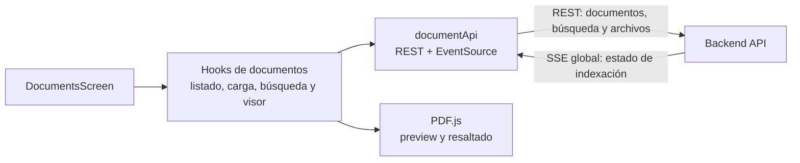

- **Biblioteca y estados:** consulta `GET /api/v1/documents` con filtros y paginación, y `GET /api/v1/documents/count` para los conteos.
- **Carga:** valida PDF/TXT/Markdown en la interfaz y envía un `POST /api/v1/documents` por archivo. El tamaño máximo del lote y la concurrencia se configuran con `VITE_MAX_DOCUMENTS_PER_BATCH` y `VITE_UPLOAD_CONCURRENCY`.
- **Tiempo real:** mantiene una sola conexión a `GET /api/v1/realtime/documents`. Los eventos incluyen el ID y el estado; el UI actualiza la cola, la biblioteca y los conteos.
- **Búsqueda:** usa `GET /api/v1/search` para los resultados full-text, con paginación y fragmentos resaltados. También inicia una búsqueda de contenido cuando el término no coincide con los documentos ya cargados localmente.
- **Visor:** obtiene metadatos y el original con `GET /api/v1/documents/:id` y `GET /api/v1/documents/:id/file`. El original se conserva para el enlace **Descargar original** y para mostrar TXT/Markdown. Para PDF solicita además `/preview`, que puede devolver la copia OCR para renderizar y resaltar; antes de que exista esa copia, devuelve el original. Las rutas tienen propósitos distintos y el UI consume ambas.
- **Edición y eliminación:** actualiza metadatos con `PATCH /api/v1/documents/:id` y elimina documentos con `DELETE /api/v1/documents/:id`.

El frontend se configura con `frontend/.env.example`; las variables del backend están en `backend/.env.example`.